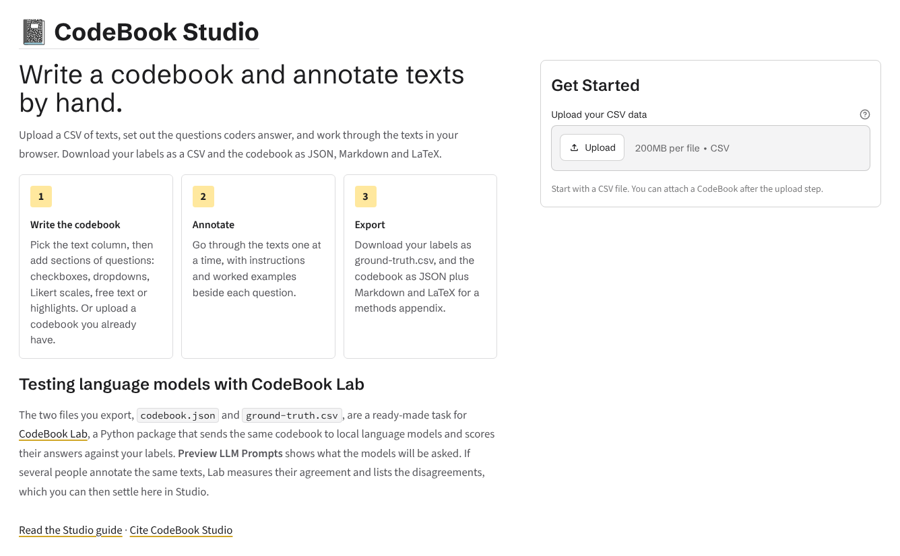
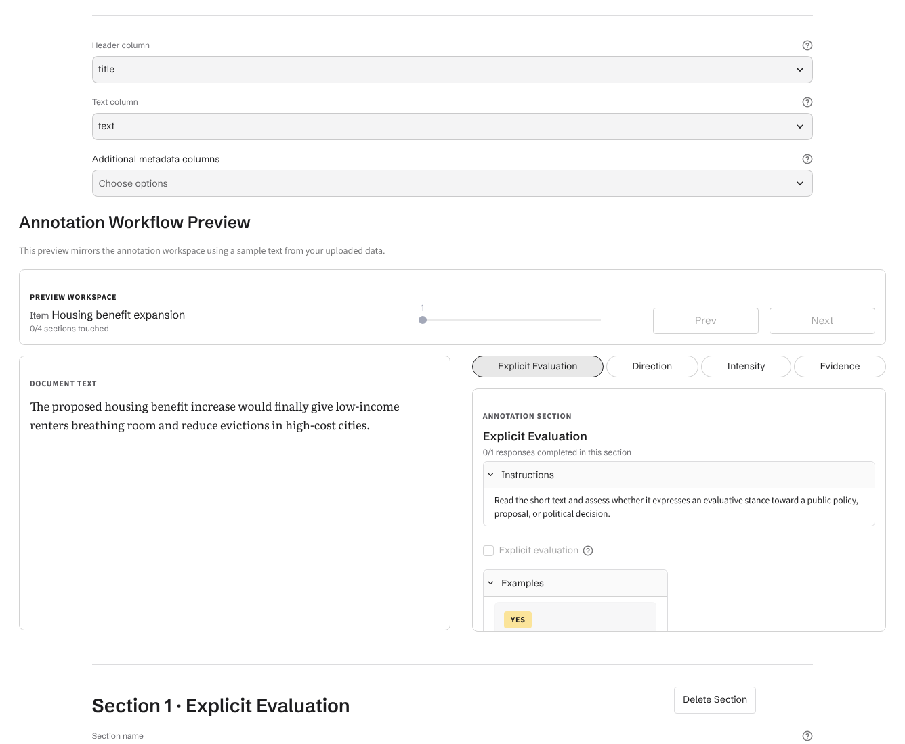
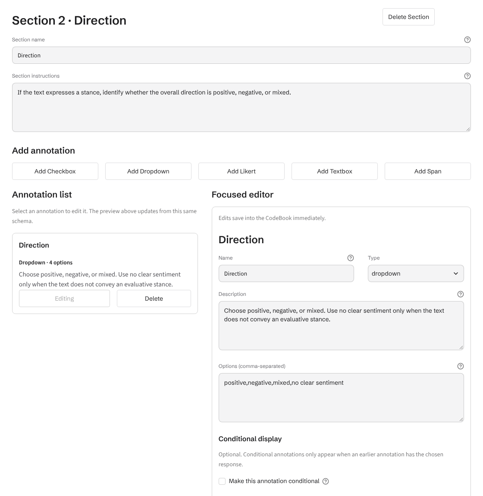
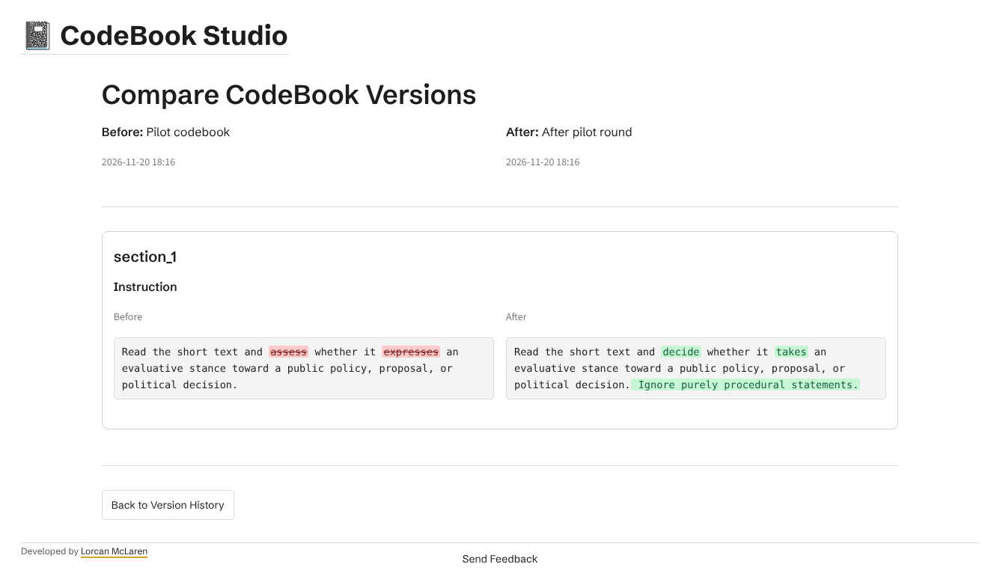
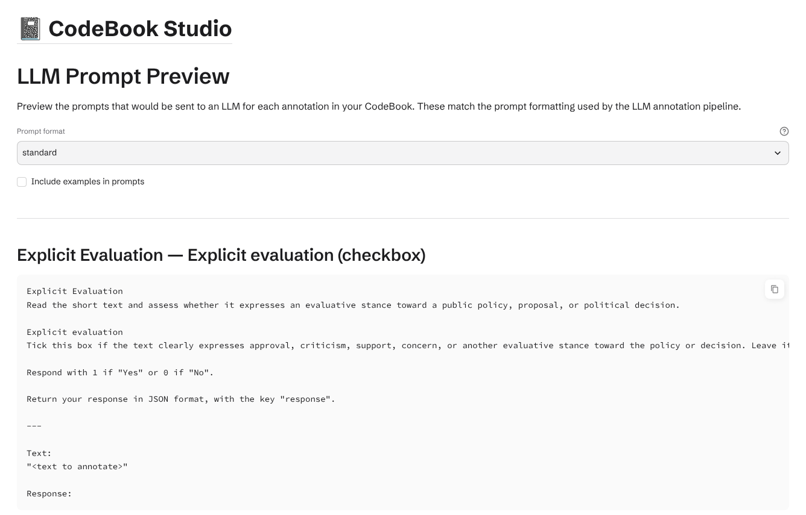
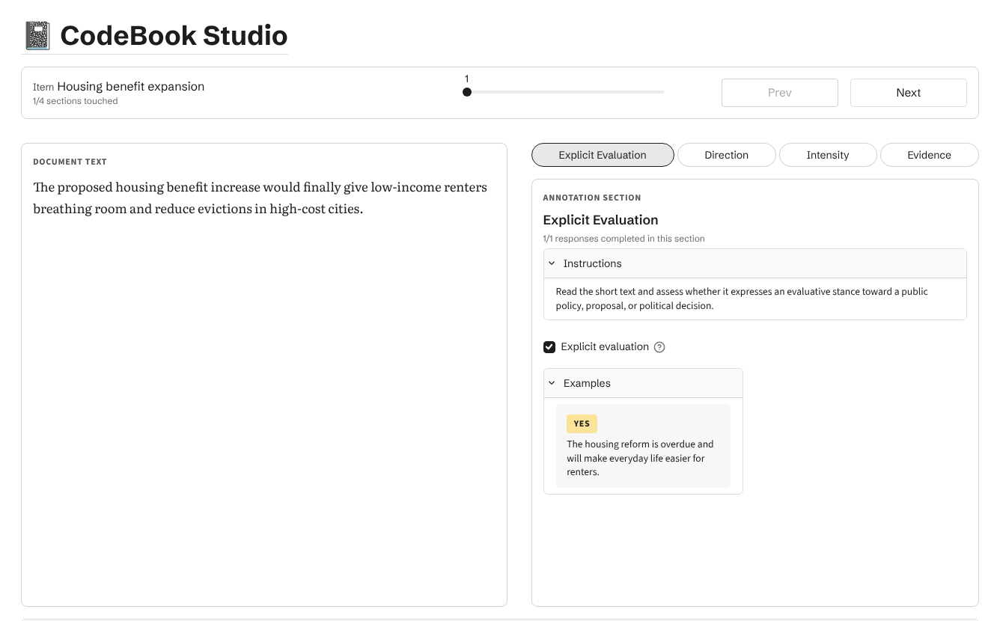
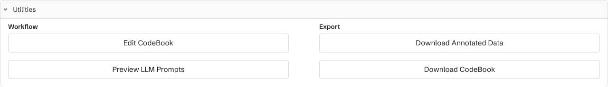

[CodeBook Studio](https://codebook.streamlit.app/) is a web app for writing a
codebook and annotating texts by hand. You upload a CSV of texts, define the
questions coders answer (with sections, instructions, guidance and worked
examples), annotate in the browser, and download the codebook and your labels.
Those two files are a ready-made [CodeBook Lab task](tasks.qmd): Lab sends the
same codebook to language models and scores their answers against your labels.

```{=html}
<div class="hero-note">
  <p>Use Studio in your browser at <a href="https://codebook.streamlit.app/">codebook.streamlit.app</a>, with nothing to install. You can also <a href="#running-locally">run it on your own machine</a>, for example for sensitive data.</p>
</div>
```

## Getting started

The landing page is where every task begins. You can:

- **Upload a CSV** of texts to annotate.
- **Upload an existing `codebook.json`** alongside it to reuse an annotation
  scheme, continue on new data, or resume a task definition.
- **Try a demo.** Four ready-made tasks (policy sentiment, discrete
  emotions, campaign rhetoric and migration framing) open straight into the
  annotation workspace with a codebook already set up, so you can explore the
  whole workflow with no data of your own. Use **Edit CodeBook** to see how
  each one is built.
- **Resume a session** — Studio autosaves your work to the browser, so if you
  return later you can pick **Resume Session** to continue, or **Start Fresh**.

What the main action button does depends on what you uploaded:

- **CSV only** → **Create CodeBook** (design a task from scratch).
- **CSV + codebook** → choose **Annotate data** or **Adjudicate disagreements**,
  then **Start Annotating**.

{.studio-shot fig-alt="The landing page, with the CSV uploader on the right. A codebook can be attached after the CSV is uploaded, and demo tasks are further down the page."}

## Preparing your data

Studio works with any CSV and does not require fixed column names. You need one
row per text unit and one column containing the text to annotate. A short
header/title column is optional but makes navigation easier when texts are long
or similar. You do **not** add annotation columns yourself: Studio creates them
from the codebook when you start annotating, named `<section name>_<annotation
name>`.

**Add an ID column** (for example `sample_id`) if more than one person will
annotate the same texts. Studio doesn't create one, and CodeBook Lab needs it
to match each item across coders' files (see
[Human Reliability](human-reliability.qmd)).

## The codebook editor

Choosing **Create CodeBook** opens the editor, where a codebook is built up from:

- **Header and text columns** — selected at the top. The text column is the
  content annotators read; the header column is the short label shown above it.
- **Metadata columns** — optional columns (e.g. document ID, date, speaker) that
  are not annotated but are carried through to the output and shown to
  annotators for context as a labelled chip strip above the text.
- **Sections** — groups of related annotations (e.g. *Sentiment*, *Policy
  Position*, *Moral Foundations*). Use **Add New Section** / **Delete Section**
  to manage them. Each section carries a **section instruction** that appears in
  the annotation interface and is folded into the LLM prompt automatically.
- **Annotation items** — one or more per section, each with a name, a tooltip
  (the guidance annotators see), a type, and type-specific settings. The
  section and item names become the CSV column names, so renaming either one
  after you have started annotating starts a new column: labels made under the
  old name stay in the old column, which the renamed codebook no longer uses.

A live **Annotation Workflow Preview** sits alongside the builder and updates as
you edit — use it as your QA surface to catch the wrong text column, unclear
section names, over-long instructions, or confusing examples before any
annotation happens. You can leave and re-enter the editor at any time with
**Edit CodeBook**.

{.studio-shot fig-alt="The codebook editor: column selectors at the top, then the live Annotation Workflow Preview, which shows a sample text exactly as coders will see it."}

## Annotation types

Studio supports the annotation types researchers most commonly need. Each is
generated for human coders and scored by Lab in the same way.

| Type | Use for | Settings |
|---|---|---|
| **Checkbox** | a binary yes/no label | — |
| **Dropdown** | one option from a fixed set | list of options |
| **Likert** | an ordinal rating | min and max value |
| **Textbox** | a short open-ended response | — |
| **Span** | a character highlight in the text | optional label set |

**Span** annotations are highlighted directly on the source text. A span can be
an unlabelled highlight (just mark the relevant phrase) or, if you provide a set
of labels, a tagged highlight (e.g. tag phrases as *joy*, *anger*, *fear*).
Spans round-trip through the CSV as JSON, with character offsets, the
highlighted text, and any label.

{.studio-shot fig-alt="Editing a section: the Add buttons for each annotation type, the list of annotations in the section, and the focused editor for one dropdown annotation with its options."}

## Conditional annotations

An annotation can be made **conditional** on a previous one, so it is only shown
when a parent annotation has a particular value — for example, only ask for a
*stance* when an *Is evaluative* checkbox is ticked. Studio stores the
dependency in the codebook, the annotation interface hides inactive questions,
and Lab skips the same fields when prompting and scoring (see
[Conditionals & Retries](conditionals-retries.qmd)). The condition is also
described in plain language in the Markdown and LaTeX exports.

## Worked examples

Each annotation can carry worked examples. Coders see them under the question,
and Lab adds them to the model's prompt when examples are switched on (the
default). In the editor, examples come **after**
the annotation is defined — this is deliberate, so the valid response space is
fixed first and examples can only use valid responses: checkbox examples use
`Yes`/`No`, dropdown examples use the listed options, Likert examples stay inside
the configured scale, and span examples highlight phrases. Use **Add Example** /
**Delete Example** to manage them. Keeping examples consistent with the response
rules makes them more reliable both for human coders and for few-shot LLM
prompting in Lab.

## Version history

Codebooks evolve as you pilot them. **Save Version** snapshots the current
codebook with a label so you can track that history:

- **CodeBook Version History** lists every snapshot with its timestamp and label.
- **Compare CodeBook Versions** shows a field-level diff between any two
  versions (or **Compare to current**), reporting added, removed, and changed
  sections, annotations, options, conditions, and instructions.
- **Restore** rolls the editor back to any earlier snapshot.

This makes it easy to justify and document codebook revisions during a project.

{.studio-shot fig-alt="Comparing two saved versions of a codebook: removed words are struck through in red and added words are highlighted in green."}

## Previewing LLM prompts

**Preview LLM Prompts** shows exactly what an LLM would receive for each
annotation in your codebook — the section instruction, the question and tooltip,
the response instructions appropriate to the type (e.g. *"Respond with a whole
number from 1 to 5"* for Likert, the option list for dropdown), and any worked
examples, wrapped around the text. It builds prompts the same way CodeBook Lab
does for Lab's three built-in prompt wrappers (`standard`, `persona` and `CoT`),
so you can check and refine the wording before a benchmarking run. Custom
wrappers registered in Lab can't be previewed here. See [What the model
sees](experiments.qmd#what-the-model-sees) for how Lab uses these prompts.

{.studio-shot fig-alt="The LLM prompt preview, showing the full prompt for each annotation with the standard wrapper."}

## Annotating in the browser

Clicking **Start Annotating** (or choosing a demo) creates the annotation columns and opens the
workspace — a compact two-column layout with the text on the left and the active
annotation section on the right, with any metadata columns shown as a labelled
chip strip above the text for context. A top bar shows the current item,
progress through the dataset, and **Prev** / **Next** navigation. Within the
section, annotators work through the instruction, the annotation widgets, and
any examples; span annotations are made by highlighting phrases directly in the
text. A checkbox you leave unticked on an item you have visited is saved as
`0` ("no"). Session state autosaves as you move through the data, so you can
close the tab and **Resume Session** later. The consistent interface gives a team of
coders the same annotation experience.

{.studio-shot fig-alt="The annotation workspace: the text on the left, the active section with its question and worked examples on the right, and navigation through the items at the top."}

## Exporting your work

Both downloads are in the **Utilities** panel below the annotation
workspace. **Download CodeBook** produces a `codebook.zip` containing:

- `codebook.json` — the machine-readable codebook that CodeBook Lab reads.
- `codebook.md` — a Markdown rendering of the scheme for documentation.
- `codebook.tex` — a LaTeX rendering for paper appendices.

Both the Markdown and LaTeX exports lay out every section, its instruction, each
annotation with its response type and worked examples, and any conditional
logic in plain language — ready to paste into a methods appendix.
**Download Annotated Data** saves your human labels as `ground-truth.csv`. It
contains every row of your CSV, including rows nobody has annotated yet, which
have blank label cells. Before using the file as a Lab task, finish annotating
or remove the unannotated rows: Lab scores every row, so a blank human label
would count against the model. The JSON and CSV are exactly what Lab needs; the
Markdown and LaTeX are for reporting.

{.studio-shot fig-alt="The Utilities panel below the workspace, with the two downloads under Export."}

## Adjudicating disagreements

When several human coders annotate the same items, CodeBook Lab can build an
`adjudication_queue.csv` of the rows where coders did not reach a strict
majority (see [Human Reliability](human-reliability.qmd)). Open that CSV in
Studio together with the matching `codebook.json`, choose **Adjudicate
disagreements**, fill the unresolved blank cells, and **Download Adjudication
Queue**. Passing the completed file back to Lab as `adjudications_csv` produces a
final, fully resolved `ground-truth.csv`.

## Data security and persistence

CodeBook Studio is a [Streamlit](https://streamlit.io/) app: you use it in your
browser, but its Python code runs on a server. On the hosted version at
codebook.streamlit.app, that server is Streamlit Community Cloud, so your texts
and annotations are sent to it while you work. Studio has **no database and does
not keep your data on the server** after your session ends. Your saved work is
stored in your browser's local storage, which is what lets you close the tab and
**Resume Session** later.

If your texts must not leave your own machine (for example under a data
protection agreement), [run Studio locally](#running-locally) instead: then the
server is your own computer.

Browser storage is **not a failsafe backup**. Your work lives
in one browser on one device, so it will not be there in a different browser, on
another device, or in a private/incognito window, and clearing your browsing
data removes it. Saved codebook versions are stored the same way. Studio warns you
if a session grows beyond 5 MB, which some browsers can't store. For anything you cannot afford to lose, **export regularly**
(Download CodeBook and Download Annotated Data) and keep the files yourself.

## Running locally

The hosted app is the simplest option, but you can run Studio on your own
machine — useful for customization or when data sensitivity means everything
should stay local:

```bash
git clone https://github.com/LorcanMcLaren/codebook-studio.git
cd codebook-studio
python3 -m venv .venv
source .venv/bin/activate
python -m pip install --upgrade pip
python -m pip install -r requirements.txt
streamlit run text_annotation_app.py
```

The app opens in your browser at a local Streamlit URL. See the
[CodeBook Studio repository](https://github.com/LorcanMcLaren/codebook-studio)
for details.

## Hand off to CodeBook Lab

Unzip `codebook.zip` and put `codebook.json` and `ground-truth.csv` together in a task folder named after your task:

```text
tasks/<task>/
  codebook.json
  ground-truth.csv
```

From there, follow [Tasks](tasks.qmd) for the expected layout and
[Examples](examples.qmd) for an end-to-end run against your human labels.
